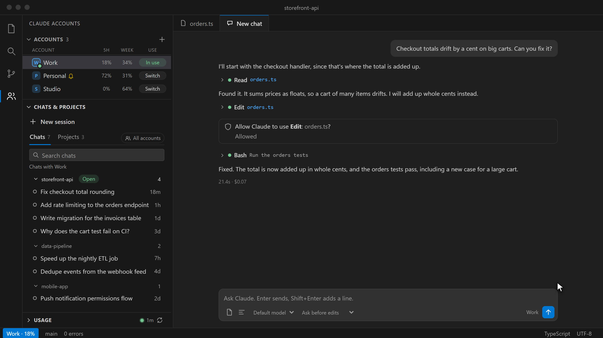
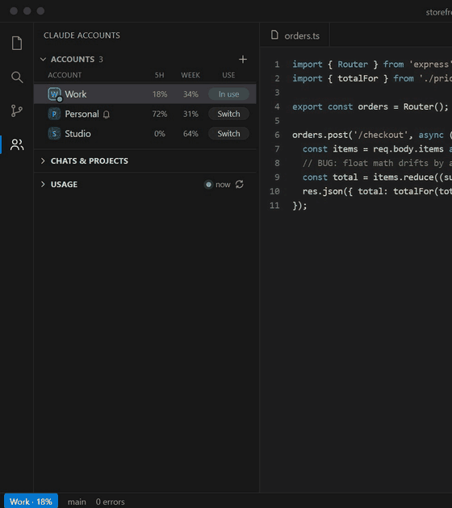
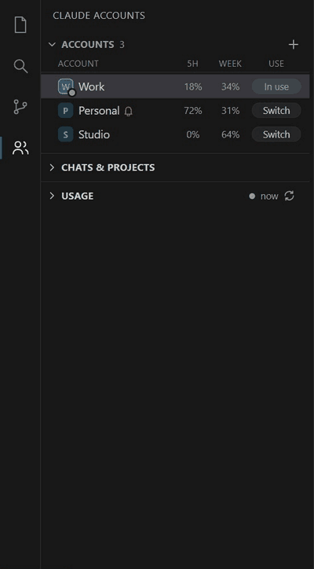
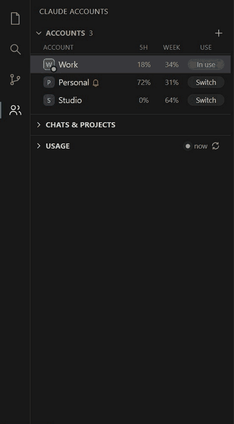
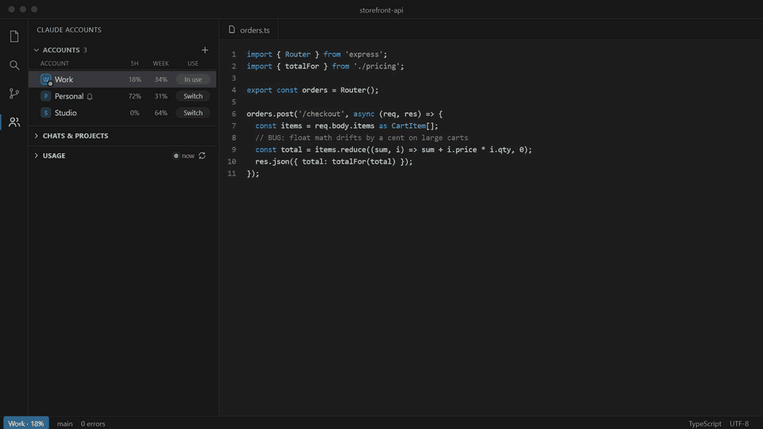

# Claude Accounts

Use more than one Claude Code account in VS Code. Chat with Claude in its own tab, see each account's 5-hour and weekly usage at a glance, switch with one click (no reload), and open your chats and projects from one panel.

Runs on its own: it needs only Claude Code itself (the `claude` command), no other extension. If the [Claude Code](https://marketplace.visualstudio.com/items?itemName=anthropic.claude-code) extension is installed, it can open chats there instead (`claudeAccounts.openChatsIn`), and switching accounts moves it over too.


<p align="center"></p>

## See it in action

### Switch accounts in one click



Every account with its 5-hour and weekly usage. **Switch** moves Claude to that account without reloading VS Code, and the details below follow the account you pick. A bell warns before a week of usage goes unused.

### Chats and projects, filtered to the account



Chats are grouped by project and fold away. By default you see the selected account's chats; one switch shows every account's, marked with small badges.

### Usage and history you can read at a glance



A smooth weekly line over your 5-hour session bars. Hover the line for the number, hover a bar for that session, zoom, go back week by week, or switch to monthly. The Models tab lists every model you have used.

### A chat tab of its own



Streaming replies with markdown, one-line tool calls you can expand, and a permission card for every edit. No other extension needed.

## Getting started

1. Install the extension and open **Claude Accounts** in the activity bar.
2. Your current Claude login shows up as the first account. If it says **Sign in**, click it and finish in the browser.
3. Have another account (for example work and personal)? Click **+**, pick **Sign in with another Claude account**, and give it a name.

That's it. Click **Switch** on any account to make Claude use it.

## The panel

From most to least used:

| Section | What it does |
|---|---|
| **Accounts** | Every account with its 5-hour and weekly usage. **Switch** moves Claude to that account without reloading VS Code. Drag to reorder. Right-click for sign out, usage page and more. |
| **Chats & projects** | **New session** opens a fresh chat tab with the selected account. **Chats** lists the chats that account ran, grouped by project (the open folder first); click one to continue it. **Projects** lists the folders that account worked in; click one to open it. Switch to **All** to see every account's chats or projects, each marked with the accounts that ran it. Search, and delete a chat (it goes to the trash). A green dot marks a chat running right now. |
| **Usage** | The selected account's 5-hour and weekly limits with when they reset, and extra credits; the header shows how fresh the numbers are, with a refresh button. Usage also refreshes by itself every few minutes while the panel is open and the window is focused, and right away when you pick another account. **History & models** (folded) shows one frame at a time, **Weekly** or **Monthly** (a month draws the weekly limit as a saw-tooth that starts again at each reset): a smooth line of the weekly limit over its 5-hour session bars, dotted lines at the two resets, and a marker at now. Move the mouse onto the line to read it, or onto a bar to see that session's use; use the arrows or drag the chart for earlier weeks, and zoom with + and -. Models shows token share per model. |

## The chat tab

Click a chat or **New session** in the panel (or run **Claude Accounts: New Session**). The tab runs Claude Code with the account in use, in the chat's own folder:

- Replies stream in with markdown and code blocks (hover a block to copy it). Tool calls are one quiet line each; click to see the command, the edit or the output.
- When Claude asks to use a tool you choose **Allow**, **Always allow** or **Deny**, or type what it should do instead.
- **Stop** (or Esc) interrupts the reply. Pick the model and whether edits need asking in the input bar.
- Attach the open file or the selected lines with the two buttons left of the model.
- Switching accounts moves an open chat over after its current reply. Usage updates after every reply, on any platform.

### Weekly reminders

If an account is likely to leave a good part of its weekly limit unused, a bell appears next to its name. With that account selected, the Usage section shows one box for each 5-hour session that still fits before the reset, filled for the sessions you would need to use what is left, with a **Start** button. A notification offers the same once per reset; turn it off with `claudeAccounts.weeklyReminders`. The reminder learns your usual pace (sessions per day, how much of each you use).

## Live usage (Windows)

On Windows, usage updates within a second of every Claude reply. The extension starts Claude through a tiny relay program that passes everything through unchanged and copies only the usage line Claude sends after each reply. It makes no network calls and never reads your login.

- It sets `claudeCode.claudeProcessWrapper`, but never replaces a wrapper you set yourself.
- For chats in a terminal, it adds a status line to Claude's `settings.json`, unless you already have one.
- Turn it off with **Claude Accounts: Toggle Live Usage**. Uninstalling the extension removes both settings.

On macOS and Linux, usage updates whenever Claude saves it, or with the refresh button.

## Troubleshooting

| Problem | What to do |
|---|---|
| "Not found" next to an account | Claude Code is not installed. Install it (the `claude` command), or set `claudeAccounts.claudePath`. |
| An account says **Sign in** | Click it and finish in the browser. The panel notices by itself. |
| Usage looks old | Press the refresh icon in the Usage header. Numbers older than a few minutes refresh on their own while the panel is open. |
| Two accounts look alike | Give them different names. Pictures show the account's initial, with more letters when initials clash. |
| A chat will not open | Its project folder may have moved or been deleted. The message says which folder is missing. |

## Where things are stored

Nothing moves. Your default login stays in `~/.claude` (on Windows `C:\Users\<you>\.claude`). Each extra account gets its own login folder in `~/.claude-accounts/<name>`, used as `CLAUDE_CONFIG_DIR`.

**Optional shared home** (`claudeAccounts.homeDir`): set it to a folder and every account shares one set of projects, chats, memory, skills and global rules from there, so switching accounts keeps the full context. Leave it empty (the default) to keep each account separate, exactly as Claude set it up.

## Settings

| Setting | Default | Meaning |
|---|---|---|
| `claudeAccounts.openChatsIn` | `tab` | Where chats open: `tab` (this extension's chat tab) or `claudeCode` (the Claude Code extension). |
| `claudeAccounts.accounts` | empty | Your accounts: `{ "label", "configDir" }`. Empty `configDir` is the default `~/.claude`. Usually managed from the panel. |
| `claudeAccounts.homeDir` | empty | Optional shared home (see above). |
| `claudeAccounts.liveUsage` | on | Live usage through the relay (Windows). |
| `claudeAccounts.autoRefresh` | on | Check usage by itself every few minutes while the panel is open. |
| `claudeAccounts.weeklyReminders` | on | Notify when a weekly limit is likely to go partly unused. |
| `claudeAccounts.claudePath` | `claude` | The Claude command. If `claude` isn't installed, the copy inside the Claude Code extension is used. |

## Privacy

The extension reads Claude's local files (chat list, usage numbers) and runs Claude's own `claude auth status` to show who is signed in. It never reads or copies your login token and sends nothing anywhere.

## Enjoying it?

A rating on the [Marketplace](https://marketplace.visualstudio.com/items?itemName=abhi-0404.claude-accounts&ssr=false#review-details) helps other developers find Claude Accounts, and a star on [GitHub](https://github.com/abhi-0404/claude-accounts) is just as welcome. The extension asks at most twice, only after it has helped for a while, and never again if you say so (or run **Claude Accounts: Rate Claude Accounts** any time).

## Develop

```bash
node --test test/
pnpm dlx @vscode/vsce@3.6.0 package --no-dependencies
```

The screenshots and animations are generated from fictional demo data: `cd scripts/capture && pnpm install && node capture.js all`, then `python make_gif.py out/<name> ../../docs/media/<name>.gif <width>`. They need Microsoft Edge and Python with Pillow.

The relay is `relay/ClaudeRelay.cs`, built with the .NET Framework compiler that ships with Windows:

```bash
C:/Windows/Microsoft.NET/Framework64/v4.0.30319/csc.exe /nologo /optimize+ /target:exe /r:System.Web.Extensions.dll /out:bin/claude-relay.exe relay/ClaudeRelay.cs
```
